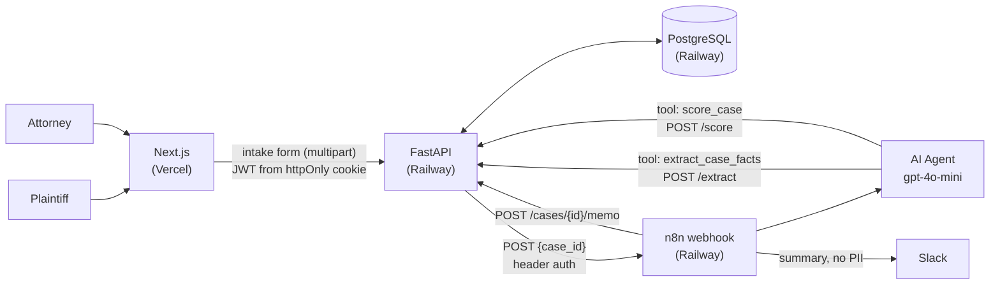

# Litigation Funding Underwriting Agent

An AI-assisted underwriting pipeline for pre-settlement litigation funding. A claimant submits an injury claim with one supporting document. The backend strips personal information before any AI sees the text. An AI agent extracts the facts an underwriter needs, each with a verbatim quote from the source that is checked against the document. Deterministic rules turn those facts into a risk score, funding range and recommendation. The agent then writes an underwriting memo, Slack gets a PII-free notification, and an attorney reviews the case and records a decision. Every action lands in an append-only audit log.

**Live demo:** https://litigation-agent-six.vercel.app
**Attorney portal:** login credentials are shared privately with reviewers.

> Synthetic data only. Nothing here is legal or financial advice.

## Contents

1. [What it does](#what-it-does)
2. [Architecture](#architecture)
3. [Key design decisions](#key-design-decisions)
4. [Security and compliance](#security-and-compliance)
5. [Evaluation results](#evaluation-results)
6. [Tech stack](#tech-stack)
7. [Repository structure](#repository-structure)
8. [Run it locally](#run-it-locally)
9. [Run the evals](#run-the-evals)
10. [Deploy it](#deploy-it)
11. [API reference](#api-reference)
12. [Environment variables](#environment-variables)
13. [Troubleshooting](#troubleshooting)
14. [Known limitations](#known-limitations)
15. [Roadmap](#roadmap)
16. [How this was built](#how-this-was-built)

## What it does

1. **Intake.** A claimant fills in the public form at `/apply` (name, contact details, injury type, description) and uploads a `.pdf` or `.txt` document of up to 10 MB.
2. **Redaction.** The backend extracts the document text in memory and redacts names, emails, phone numbers, SINs, SSNs and dates of birth. It stores only the redacted text and discards the original file. It then calls the n8n webhook with the new case ID.
3. **Agent.** An n8n AI Agent (`gpt-4o-mini`) calls two backend tools. `extract_case_facts` (`POST /extract`) returns injury type, incident date, liability indicators, insurance coverage and claimed damages, each with a verbatim source quote and a `grounded` flag. `score_case` (`POST /score`) applies deterministic rules to produce a risk score (0 to 100, higher is riskier), a funding range, a fund/review/decline recommendation, and the factors behind them.
4. **Memo.** The agent writes a Markdown underwriting memo from the tool results only: summary, key facts with source quotes, unverified fields flagged, risk assessment, recommendation and diligence items. It saves the memo through `POST /cases/{id}/memo`, which moves the case to *Ready for review*.
5. **Slack notification.** n8n posts injury type, risk score, recommendation, funding range and a dashboard link to Slack. There's no claimant PII in the message.
6. **Attorney review.** The attorney signs in, opens the case, and reads the memo, extracted facts with their quotes and grounding badges, scoring factors, redaction summary and audit trail. They then approve, decline (with a confirmation step) or mark the case *Needs info*, with an optional note. Every view and decision is written to the audit log.

## Architecture



| Component | Responsibilities |
|---|---|
| **Next.js frontend** (Vercel) | Public intake form. Attorney login through a route handler that sets an httpOnly cookie. Dashboard and case review pages rendered on the server. Decision buttons implemented as a server action. `src/proxy.ts` redirects requests without a session cookie to `/login`. |
| **FastAPI backend** (Railway) | The only component with database access. Text extraction, PII redaction, case storage, the agent's tool endpoints, deterministic scoring, JWT auth and audit logging. Triggers n8n after intake. |
| **PostgreSQL** (Railway) | `cases`, `users` and `audit_log`. A trigger makes `audit_log` append-only. |
| **n8n** (Railway) | Workflow: Webhook → AI Agent (with the `extract_case_facts` and `score_case` HTTP tools and an OpenAI chat model) → Save memo → Notify Slack. |
| **OpenAI** `gpt-4o-mini` | Fact extraction (JSON mode, temperature 0), a plain-language explanation of the score, and the agent's memo. It never sets the score or the funding range. |
| **Slack** | Incoming webhook notification for each case ready for review. |

## Key design decisions

- **Rules decide, the LLM explains.** The risk score, funding range and recommendation come from `backend/lfa/scoring.py`: keyword-based liability rules, insurance and damages checks, a limitation-period check, an injury-severity multiplier, and a penalty for ungrounded facts. The LLM only writes a short explanation and is told not to change or invent numbers. Every factor is shown to the attorney with its impact and evidence.
- **Every fact carries a verbatim quote, and the quote is checked.** Extraction returns a `source_text` for each value. The backend normalizes whitespace and quotes and confirms that the quote appears in the redacted document. Values that fail are marked *Unverified* in the UI and add risk in scoring.
- **Small, separate agent tools.** The agent has exactly two tools, each a normal authenticated API endpoint with one job. Each call is audit-logged, testable on its own, and reusable outside n8n (the eval suite calls `/extract` directly).
- **All writes go through the API.** n8n never touches the database. Intake, extraction, scoring, memo saves, attorney views and decisions all pass through endpoints that write an `audit_log` row recording who acted.
- **Raw uploads are never persisted.** The file is read into memory, converted to text, redacted, and discarded. Only the redacted text and the filename are stored.
- **The Slack payload has no PII.** The memo endpoint returns only case ID, injury type, risk score, funding range, recommendation and status, which is all n8n forwards to Slack.

## Security and compliance

| Control | Implementation |
|---|---|
| PII redaction before any LLM call | Regex redaction (`backend/lfa/redaction.py`) of emails, SSNs, phone numbers, SINs and dates of birth; the claimant's name from the intake form; names after labels such as `Patient:`, `Driver 1:`, `Claimant:` or `Witness:`; and names after titles such as `Mr.` or `Officer`. Redaction counts are stored and shown to the attorney. |
| Append-only audit log | Every create, extract, score, memo save, view, decision and login attempt writes an `audit_log` row (actor, action, details, IP, timestamp). A PostgreSQL trigger raises an exception on any `UPDATE` or `DELETE`. |
| Passwords and sessions | Passwords are hashed with bcrypt, and unknown emails take the same time to reject as wrong passwords. The JWT is HS256 with an 8-hour expiry. The browser receives it only as an `httpOnly`, `SameSite=Lax` cookie, set `Secure` in production. There's no `localStorage` or `sessionStorage`. |
| Server-side data fetching | Dashboard pages and the decision server action call the backend from the Next.js server (`src/lib/backend.ts`, marked `server-only`, `cache: 'no-store'`). The token never reaches client JavaScript, and a 401 from the backend redirects to `/login`. |
| Service-to-service auth | n8n calls the tool and memo endpoints with an `X-Service-Token` shared secret, compared with `hmac.compare_digest` (constant time). |
| Webhook auth | The n8n webhook requires header auth, so only the backend can start a run. |
| Data minimization | The LLM sees only redacted document text. Claimant contact details are stored for attorneys only and are never sent to the AI. Slack receives no PII. Raw files are never stored. |
| Secrets handling | All secrets live in environment variables. The `.env` files are git-ignored, the `.env.example` files hold placeholders only, and the n8n exports reference credentials by ID and use a placeholder for the Slack webhook URL. |
| Frontend accessibility and safety | Audited against Vercel's Web Interface Guidelines: skip link, labelled inputs, inline field errors with focus management, `aria-live` status messages, visible focus rings, WCAG AA colour contrast, and a confirmation step before *Decline*. |

## Evaluation results

The eval suite sends 15 deterministic, synthetic, labeled cases through the real `/extract` endpoint. The cases mix clear and disputed liability; full, partial and missing insurance; total-line, itemized, prose-only and missing damages; five injury types; three date formats; a claim older than two years; and names written in unlabeled prose. Full report: [evals/results.md](evals/results.md).

| Metric | Result |
|---|---|
| Injury type | 15/15 (100.0%) |
| Incident date | 15/15 (100.0%) |
| Insurer | 15/15 (100.0%) |
| Policy limit | 15/15 (100.0%) |
| Claimed damages | 12/15 (80.0%) |
| Liability indicators | 11/15 (73.3%) |
| **Overall field accuracy** | **83/90 (92.2%)** |
| Grounding rate (source quotes found verbatim) | 80/82 (97.6%) |
| PII leaks, document only | 2 of 60 planted (recall 96.7%) |
| PII leaks, with intake-form name (production path) | 0 of 60 planted (recall 100.0%) |

**What the failures show** (from [evals/analysis.md](evals/analysis.md)):

- **Itemized damages.** The model got the sum wrong on every bill that listed items without a total (5 of 5). Two pass only because of the 1% tolerance; under exact matching damages would be 10/15. On two bills it also invented a "Total" line that isn't in the document. The grounding check flagged both, which accounts for the 2 ungrounded quotes.
- **Disputed liability.** In both conflicting-witness cases, the model listed each witness's claim as plain fact and dropped the fact that the accounts conflict. A downstream rule could then score a disputed case as favorable.
- **Incomplete liability lists.** Two cases returned true but incomplete indicators, missing the rear-end impact in one and the ice in the other.
- **Redaction.** The 2 document-only leaks are claimant names written in unlabeled prose. They disappear when the intake-form name is supplied, which is what production does.

No prompts or scoring rules were tuned to improve these results.

## Tech stack

| Layer | Technology |
|---|---|
| Frontend | Next.js 16 (App Router, Cache Components, Server Actions, `proxy.ts`), React 19, TypeScript, Tailwind CSS 4, react-markdown, `next/font` (Source Serif 4, Inter) |
| Backend | Python, FastAPI, Uvicorn, SQLAlchemy 2, psycopg2, PyJWT, bcrypt, pypdf, httpx |
| AI | OpenAI `gpt-4o-mini` (JSON mode for extraction), n8n AI Agent node |
| Data | PostgreSQL 16 |
| Orchestration | n8n (Webhook, AI Agent, HTTP Request tools, Slack via incoming webhook) |
| Infrastructure | Docker Compose (local), Railway (backend, Postgres, n8n), Vercel (frontend) |

## Repository structure

```text
litigation-agent/
├── backend/                     FastAPI service (deployed to Railway)
│   ├── main_lfa.py              App entry point: CORS, routes, init_db on startup
│   ├── create_attorney.py       CLI to create or reset an attorney login
│   ├── lfa/
│   │   ├── config.py            Environment variables (required ones fail fast)
│   │   ├── db.py                Engine, sessions, table creation, append-only audit trigger
│   │   ├── models.py            Case, User, AuditLog
│   │   ├── documents.py         PDF and text extraction (pypdf)
│   │   ├── redaction.py         Regex PII redaction
│   │   ├── extraction.py        LLM fact extraction and grounding check
│   │   ├── scoring.py           Deterministic risk rules and LLM explanation
│   │   ├── llm.py               OpenAI client (temperature 0, JSON mode)
│   │   ├── security.py          bcrypt, JWT, service token, audit writer
│   │   └── routes.py            All HTTP endpoints
│   ├── samples/case_001.txt     Synthetic police report and hospital bill
│   ├── requirements.txt         Dependencies (identical to requirements-lfa.txt)
│   ├── .python-version          3.12 (used by Railway)
│   ├── Procfile                 Railway start command
│   └── .env.example             Backend variables (placeholders)
├── frontend/                    Next.js app (deployed to Vercel)
│   ├── src/proxy.ts             Redirects /dashboard/* to /login without a session cookie
│   ├── src/lib/backend.ts       Server-only backend client (reads the httpOnly cookie)
│   ├── src/lib/                 Types, formatting, shared UI class strings
│   ├── src/components/badges.tsx  Status, risk score and grounding badges
│   └── src/app/
│       ├── page.tsx             Landing page
│       ├── apply/               Public intake form
│       ├── login/               Attorney sign-in
│       ├── api/auth/            Login (sets cookie) and logout route handlers
│       └── dashboard/           Case table; [id]/ case review, decision server action, memo renderer
├── n8n/
│   ├── underwriting-workflow.json             Workflow for local Docker n8n
│   └── underwriting-workflow.production.json  Same workflow pointed at the Railway backend
├── evals/
│   ├── generate_cases.py        Deterministic synthetic case generator (no LLM)
│   ├── run_evals.py             Field accuracy, grounding and PII leak checks
│   ├── cases/                   15 cases and labels.json ground truth
│   ├── analysis.md              Hand-written failure analysis
│   └── results.md / results.json  Latest results
├── docker-compose.yml           Local PostgreSQL and n8n
├── CLAUDE.md                    Project rules and frontend design system
└── .claude/skills/              Design and React skills used while building
```

## Run it locally

**Prerequisites:** Docker Desktop, Python 3.12+, Node.js 20+, an OpenAI API key, and optionally a Slack incoming webhook URL.

Commands are for Windows PowerShell. On macOS or Linux, use `python3`, `source venv/bin/activate` or `venv/bin/python`, `cp` instead of `copy`, and `curl` instead of `curl.exe`.

1. **Start PostgreSQL and n8n.**

   ```powershell
   docker compose up -d
   ```

2. **Set up the backend.**

   ```powershell
   cd backend
   python -m venv venv
   venv\Scripts\python.exe -m pip install -r requirements.txt
   copy .env.example .env
   venv\Scripts\python.exe -c "import secrets; print(secrets.token_hex(32))"   # run twice
   ```

   In `backend\.env`, set `OPENAI_API_KEY`, and paste one generated value into `JWT_SECRET` and the other into `SERVICE_TOKEN`. Then create an attorney login and start the API:

   ```powershell
   venv\Scripts\python.exe create_attorney.py attorney@firm.test "choose-a-strong-password"
   venv\Scripts\python.exe -m uvicorn main_lfa:app --reload --host 0.0.0.0 --port 8000
   ```

   `--host 0.0.0.0` is required so the n8n container can reach the API. Check http://localhost:8000/health.

3. **Set up n8n** at http://localhost:5678.
   1. Create a **Header Auth** credential named `Backend Service Token`: name `X-Service-Token`, value your `SERVICE_TOKEN`. Create an **OpenAI** credential with your API key.
   2. Import `n8n\underwriting-workflow.json` (**Import from file**).
   3. Re-select the credentials: `Backend Service Token` on **Webhook**, **extract_case_facts**, **score_case** and **Save memo**, and `OpenAI` on **OpenAI Chat Model**.
   4. In **Notify Slack**, replace `REPLACE_WITH_SLACK_WEBHOOK_URL` with your Slack incoming webhook URL, and `REPLACE_WITH_VERCEL_URL` with your frontend host (for example `localhost:3000`, changing `https` to `http`). If you don't use Slack, delete the node.
   5. Click **Publish** so the production webhook (`/webhook/new-case`) goes live.

   The workflow calls the backend at `http://host.docker.internal:8000`. Inside the n8n container, `localhost` means the container itself, and `host.docker.internal` resolves to your machine. `docker-compose.yml` maps it with `extra_hosts`. The backend reaches n8n the other way, through the published port: `N8N_WEBHOOK_URL=http://localhost:5678/webhook/new-case`.

4. **Set up the frontend** (in a new terminal).

   ```powershell
   cd frontend
   copy .env.example .env.local
   npm install
   npm run dev
   ```

   `.env.local` needs `NEXT_PUBLIC_API_URL=http://localhost:8000` and `BACKEND_URL=http://localhost:8000`.

5. **Test the full flow.**
   1. Open http://localhost:3000/apply and submit a case with `backend\samples\case_001.txt`.
   2. Within about 15 seconds the backend log should show `POST /extract`, `POST /score` and `POST /cases/{id}/memo` from n8n, and Slack should get a message.
   3. Sign in at http://localhost:3000/login, open the case from the dashboard, check the memo, facts and audit trail, and record a decision.

   To test the API without the UI:

   ```powershell
   curl.exe -X POST http://localhost:8000/cases -F "claimant_name=Priya Raman" -F "claimant_email=priya.raman@example.com" -F "injury_type=wrist fracture" -F "incident_description=I was hit by a car that ran a red light at King and University." -F "file=@backend\samples\case_001.txt"
   ```

## Run the evals

With the backend running locally:

```powershell
backend\venv\Scripts\python.exe evals\generate_cases.py      # writes evals\cases\ (deterministic)
backend\venv\Scripts\python.exe evals\run_evals.py           # calls /extract, writes results.json and results.md
backend\venv\Scripts\python.exe evals\run_evals.py --render-only   # rebuild results.md from results.json, no API calls
```

`run_evals.py` reads `SERVICE_TOKEN` from `backend\.env` and never prints it. Set `LFA_API_URL` to evaluate another backend. See [evals/README.md](evals/README.md) for the scoring rules.

## Deploy it

### Railway: backend and PostgreSQL

1. Create a Railway project and add the **PostgreSQL** plugin.
2. Add a service from this GitHub repo with **Root Directory** `/backend`. Railway uses `requirements.txt`, `.python-version` (3.12) and the `Procfile` start command `uvicorn main_lfa:app --host 0.0.0.0 --port $PORT`.
3. Set **Healthcheck Path** to `/health`.
4. Set the variables listed in [Backend variables](#backend). Use `${{Postgres.DATABASE_URL}}` for `DATABASE_URL`; the app converts `postgres://` URLs to the psycopg2 driver itself. Set `FRONTEND_ORIGINS` to your Vercel URL and `N8N_WEBHOOK_URL` to the Railway n8n production webhook URL.
5. Deploy all staged changes, then generate a public domain.
6. Create the attorney login from the service's **Console** tab: `python create_attorney.py attorney@firm.test "choose-a-strong-password"`.

### Railway: n8n

1. Add a service from the Docker image **`n8nio/n8n`**.
2. Attach a volume mounted at **`/home/node/.n8n`**. n8n keeps its database, credentials and workflows there.
3. Set these variables:

   | Variable | Value |
   |---|---|
   | `N8N_ENCRYPTION_KEY` | A long random string. Keep it stable, because it encrypts stored credentials. |
   | `N8N_HOST` | Your n8n Railway domain, without `https://` |
   | `N8N_PROTOCOL` | `https` |
   | `N8N_PORT` | `5678` (and point the Railway domain at port 5678) |
   | `WEBHOOK_URL` | `https://<your n8n domain>/` so webhook URLs use the public domain |
   | `GENERIC_TIMEZONE` | For example `America/Toronto` |
   | `RAILWAY_RUN_UID` | `0` |

   **Why `RAILWAY_RUN_UID=0`:** Railway mounts volumes owned by root, and the n8n image runs as the unprivileged `node` user, so n8n crashes with `EACCES` when it tries to write to `/home/node/.n8n`. Running the container as root fixes that. The trade-off is a weaker container boundary if n8n is ever compromised; see [Known limitations](#known-limitations).
4. Open n8n, create the owner account, create the `Backend Service Token` and `OpenAI` credentials, import `n8n\underwriting-workflow.production.json` (which calls `https://litigation-agent-production.up.railway.app`), re-select the credentials, set the Slack and Vercel URLs, and **Publish**.

### Vercel: frontend

1. Import the repo with **Root Directory** `frontend`. The Next.js framework preset is detected automatically.
2. Set `BACKEND_URL` and `NEXT_PUBLIC_API_URL` to the Railway backend URL.
3. Redeploy after changing any `NEXT_PUBLIC_` variable, because those values are baked into the browser bundle at build time.
4. On the Railway backend, set `FRONTEND_ORIGINS` to the Vercel URL (for example `https://litigation-agent-six.vercel.app`) so the browser's direct intake upload passes CORS.

## API reference

FastAPI backend:

| Method | Path | Auth | Purpose |
|---|---|---|---|
| GET | `/health` | None | Liveness check, returns `{"status":"ok"}` |
| POST | `/cases` | None (public intake) | Multipart form with a document. Redacts, stores and triggers n8n. Returns `{case_id, status}`. |
| POST | `/auth/login` | None | Email and password. Returns a JWT. Failed attempts are audit-logged. |
| POST | `/extract` | `X-Service-Token` | Agent tool. `{case_id}` extracts and stores facts; `{text}` redacts and extracts without storing (used by the evals). |
| POST | `/score` | `X-Service-Token` | Agent tool. Rule-based score, funding range, recommendation and factors, plus an LLM explanation. |
| POST | `/cases/{id}/memo` | `X-Service-Token` | Saves the memo, sets *Ready for review*, and returns a PII-free summary for Slack. |
| GET | `/cases` | Bearer JWT | Case list, newest first (up to 200) |
| GET | `/cases/{id}` | Bearer JWT | Full case: claimant, redacted text, extraction, factors, memo. Logs `case.viewed`. |
| PATCH | `/cases/{id}` | Bearer JWT | `{status: approved \| declined \| needs_info \| ready_for_review, note?}` |
| GET | `/cases/{id}/audit` | Bearer JWT | Audit trail for the case, oldest first |

Next.js route handlers:

| Method | Path | Purpose |
|---|---|---|
| POST | `/api/auth/login` | Calls the backend from the server and sets the `lfa_token` httpOnly cookie |
| POST | `/api/auth/logout` | Clears the cookie and redirects to `/login` |

## Environment variables

Optional variables should be **deleted** rather than left empty. An empty value counts as set, so for example an empty `OPENAI_MODEL` overrides the default, and an empty `LIMITATION_YEARS` fails to parse.

### Backend

| Variable | Required | Description |
|---|---|---|
| `DATABASE_URL` | Yes | PostgreSQL URL (`postgres://` and `postgresql://` are both accepted) |
| `OPENAI_API_KEY` | Yes | OpenAI API key |
| `JWT_SECRET` | Yes | Secret for signing attorney JWTs (`secrets.token_hex(32)`) |
| `SERVICE_TOKEN` | Yes | Shared secret for n8n → backend calls and the n8n webhook header |
| `N8N_WEBHOOK_URL` | Recommended | n8n production webhook URL. If missing, cases stay at *Submitted*. |
| `FRONTEND_ORIGINS` | Recommended | Comma-separated CORS origins. Default `http://localhost:3000`. |
| `OPENAI_MODEL` | Optional | Default `gpt-4o-mini` |
| `JWT_EXPIRE_MINUTES` | Optional | Default `480` (8 hours) |
| `MAX_UPLOAD_MB` | Optional | Default `10` |
| `LIMITATION_YEARS` | Optional | Limitation period used in scoring. Default `2` (Ontario). |

### Frontend

| Variable | Exposed to browser | Description |
|---|---|---|
| `BACKEND_URL` | No | Backend URL for server-side calls (login, dashboard, decisions) |
| `NEXT_PUBLIC_API_URL` | Yes | Backend URL for the intake form's direct upload. Baked in at build time. |

## Troubleshooting

| Symptom | Cause and fix |
|---|---|
| n8n webhook returns `403 Authorization data is wrong!` | The Header Auth credential's value doesn't exactly match `SERVICE_TOKEN`, often because it was only partly copied or has trailing whitespace. Paste the full value again. |
| `/extract` works but `/score` (or Save memo) returns 401 | That node has no credential selected. Re-select `Backend Service Token` on every HTTP node after importing. |
| n8n can't reach the backend locally | Use `http://host.docker.internal:8000`, not `localhost`, inside n8n, and start uvicorn with `--host 0.0.0.0`. |
| Case stuck at *Submitted* | `N8N_WEBHOOK_URL` is missing, so the backend logs a warning and skips the trigger, or the workflow isn't published. |
| Case shows *Workflow not started* (`trigger_failed`) | The backend reached n8n but got an error, usually a 404 from an unpublished or wrong webhook path, or a 403 from header auth. The audit trail records the error. |
| Workflow edits have no effect | The production webhook runs the published version. Click **Publish** after editing. |
| Railway build fails to detect Python | The service has no root directory. Set **Root Directory** to `/backend`. |
| Variable changes don't apply | Railway stages variable changes. Deploy the staged changes. |
| Railway URL shows "train has not arrived" | No deployment is serving that domain yet, or the domain points at the wrong port. Wait for the deploy to finish and check the domain's target port. |
| Backend fails on first boot with a Postgres connection timeout | Postgres was still starting. Redeploy the backend. |
| n8n crashes with `EACCES` on `/home/node/.n8n` | The volume is owned by root. Set `RAILWAY_RUN_UID=0`. |
| Railway rejects the image `docker.n8n.io/n8nio/n8n` | Use the Docker Hub name `n8nio/n8n`. |
| Browser shows a CORS error on the intake form | Add the exact frontend origin to `FRONTEND_ORIGINS` on the backend, with no trailing slash, and redeploy. |
| Intake form still calls the old backend URL | `NEXT_PUBLIC_API_URL` is baked in at build time. Redeploy Vercel after changing it. |
| `curl` in PowerShell rejects `-F` or `-H` flags | `curl` is an alias for `Invoke-WebRequest` in Windows PowerShell. Use `curl.exe`. |
| Case page shows *Extracted* or *Scored* with no memo | The workflow is still running. Refresh after a few seconds. |

## Known limitations

- **Single role.** There's no RBAC yet: any authenticated attorney can view and decide every case.
- **Regex redaction has limits.** Names written in prose without a label, title or form match are not redacted, which is what caused the 2 document-only leaks in the evals. Witnesses and other third parties named in prose can leak the same way.
- **No OCR.** Scanned PDFs without a text layer are rejected.
- **Weakest extraction areas: itemized damages and disputed liability.** The model miscalculates sums of itemized bills, and it reports conflicting witness accounts as facts (see [Evaluation results](#evaluation-results)).
- **Intake/document mismatch is not flagged.** The case page shows the claimant's reported injury next to the extracted one, but a mismatch (for example whiplash reported with a fracture document) raises no warning and doesn't affect the score.
- **Illustrative scoring.** The rules and weights demonstrate the approach. They are not actuarial or calibrated against real outcomes.
- **No rate limiting** or CAPTCHA on the public intake endpoint.
- **n8n runs as root on Railway** (`RAILWAY_RUN_UID=0`) to work around volume permissions.
- **Synthetic data only.** It has not been tested on real case files.

## Roadmap

- Compute damages in code from extracted line items, each with its own quote, instead of trusting the model's sum.
- Detect disputed liability (an explicit `disputed` flag or attribution per indicator) and add a scoring rule for it.
- Role-based access control: attorney, reviewer and admin roles, and case assignment.
- Flag mismatches between the intake form and the document as diligence items.
- Rate limiting and CAPTCHA on public intake.
- OCR for scanned PDFs.
- NER-based redaction alongside the regex, measured with the existing PII leak check.
- Alembic migrations instead of `create_all`.
- Asynchronous extraction with Celery and Redis.
- Run the evals in CI with a regression threshold.

