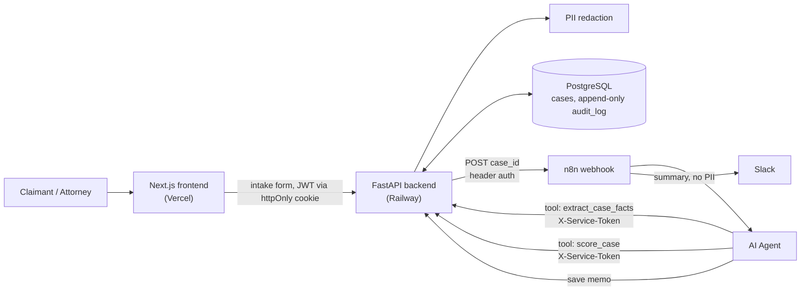

# Litigation Funding Underwriting Agent

An AI-assisted underwriting pipeline for pre-settlement litigation funding. A claimant submits an injury claim and one supporting document. The system strips personal information, extracts the facts an underwriter needs (injury, incident date, liability, insurance, damages), and checks that every extracted fact is quoted verbatim from the source. Deterministic rules then compute a risk score and funding range, and an AI agent writes an underwriting memo for an attorney to approve, decline or send back for more information. Every step is audit-logged.

**Live demo:** <VERCEL_URL>
**Demo video:** <VIDEO_URL>

> Demo with synthetic data only. No real personal information.

## Architecture



- **Next.js frontend (Vercel).** Public intake form, attorney login, case dashboard, and case review page with the memo, extracted facts and source quotes, scoring factors, redaction summary and audit trail. All attorney data is fetched server-side. The browser never sees the JWT.
- **FastAPI backend (Railway).** The only component that touches the database. It redacts uploads, stores cases, exposes the agent's tools as authenticated endpoints, and writes an audit entry for every action.
- **PostgreSQL.** Cases, users and an append-only audit log.
- **n8n.** Orchestrates the agent. A webhook receives the new case ID. An AI Agent node calls the backend's `extract_case_facts` (`POST /extract`) and `score_case` (`POST /score`) tools, writes the memo, saves it through `POST /cases/{id}/memo`, and posts a PII-free summary to Slack.
- **OpenAI (`gpt-4o-mini`).** Used for fact extraction, the score explanation and the memo. It never sets the score.

## How it works

1. **Intake.** The claimant submits the form and a `.pdf` or `.txt` document. The backend extracts the text, redacts PII, stores only the redacted text, and discards the raw file.
2. **Trigger.** The backend calls the n8n webhook with the case ID.
3. **Extract.** The agent calls `extract_case_facts`. The LLM returns each fact with a verbatim `source_text` quote, and the backend checks each quote against the redacted document (the grounding check).
4. **Score.** The agent calls `score_case`. Rules compute the risk score, funding range and recommendation from the extracted facts. These include a limitation-period check, and penalties for ungrounded values. The LLM only writes a plain-language explanation of the rule factors.
5. **Memo and review.** The agent writes a memo citing the source quotes and saves it, and Slack gets a summary. An attorney reviews the case in the dashboard and records a decision.

## Key design decisions

- **Rules decide, the LLM explains.** The risk score, funding range and fund/review/decline decision come from deterministic, auditable rules (`backend/lfa/scoring.py`). The LLM's explanation is told not to change or invent numbers.
- **Agent tools are separate, auditable endpoints.** The n8n agent cannot touch the database. Each tool is a backend endpoint with its own authentication and audit entry, so every agent action can be traced.
- **All writes go through the API.** Intake, extraction, scoring, memos, attorney views and decisions are each recorded in `audit_log` with the acting user or service.
- **Raw uploads are never persisted.** Text is extracted in memory, redacted, and only the redacted text is stored.
- **The Slack payload contains no PII.** Only case ID, injury type, score, range, recommendation and status.

## Security and compliance

- **PII redaction before any LLM call.** Regex redaction of names (from the intake form, labelled lines such as `Patient:` or `Driver 1:`, and titles such as `Officer`), emails, phone numbers, SINs, SSNs and dates of birth.
- **Append-only audit log.** A PostgreSQL trigger rejects any `UPDATE` or `DELETE` on `audit_log`.
- **JWT in an httpOnly cookie.** Login goes through a Next.js route handler, so the token is never readable by browser JavaScript (`SameSite=Lax`, `Secure` in production, 8-hour expiry). No `localStorage`.
- **Server-side data fetching.** Dashboard pages and the decision action call the backend from the server, and a proxy (`src/proxy.ts`) redirects unauthenticated requests to `/login`.
- **Service-to-service authentication.** n8n authenticates to the agent-tool endpoints with an `X-Service-Token` shared secret. The n8n webhook itself requires header auth.
- **Secrets only in environment variables.** Nothing secret is committed; `.env.example` files list the keys.

## Evaluation

The eval suite (`evals/`) runs 15 deterministic, synthetic, labeled cases through the real `/extract` endpoint. The cases cover clear and disputed liability, missing insurance, itemized bills, prose-only facts, mixed date formats, and a claim older than two years. Full results and failure analysis: [evals/results.md](evals/results.md).

| Metric | Result |
|---|---|
| Injury type | 15/15 (100.0%) |
| Incident date | 15/15 (100.0%) |
| Insurer | 15/15 (100.0%) |
| Policy limit | 15/15 (100.0%) |
| Claimed damages | 12/15 (80.0%) |
| Liability indicators | 11/15 (73.3%) |
| **Overall field accuracy** | **83/90 (92.2%)** |
| Grounding rate (source quotes found verbatim) | 80/82 (97.6%) |
| PII leaks, document only | 2 of 60 planted (recall 96.7%) |
| PII leaks, with intake-form name (production path) | 0 of 60 planted (recall 100.0%) |

- **Grounding check.** Every extracted value carries a `source_text` quote, and the backend verifies that the quote appears verbatim in the redacted document. Ungrounded values are flagged in the UI and add risk in scoring. In this run the check caught the model inventing a "Total" line on two itemized bills.
- **PII leak check.** Planted claimant PII (name, phone, email, SIN or SSN) is redacted locally, and surviving strings are counted. The two document-only leaks are names written in unlabeled prose. They disappear when the intake-form name is supplied, which is what production does.
- **What failed.** The model gets the sum of an itemized bill wrong (0 of 5 exact; 2 pass the 1% tolerance), and it turns conflicting witness accounts into plain facts. See the [failure analysis](evals/results.md#failure-analysis).

## Tech stack

Next.js 16 (App Router, Cache Components, Server Actions), React 19, TypeScript, Tailwind CSS 4, react-markdown · FastAPI, SQLAlchemy 2, PostgreSQL 16, PyJWT, bcrypt, pypdf · OpenAI `gpt-4o-mini` · n8n (AI Agent, webhook, Slack) · Docker Compose · Vercel, Railway.

## Local setup

Prerequisites: Docker Desktop, Python 3.12+, Node.js 20+, an OpenAI API key.

```powershell
# 1. PostgreSQL and n8n
docker compose up -d

# 2. Backend
cd backend
python -m venv venv
venv\Scripts\python.exe -m pip install -r requirements.txt
copy .env.example .env      # then set OPENAI_API_KEY, JWT_SECRET and SERVICE_TOKEN
venv\Scripts\python.exe create_attorney.py attorney@firm.test "ChangeMe-Now-2026"
venv\Scripts\python.exe -m uvicorn main_lfa:app --reload --port 8000

# 3. Frontend (new terminal)
cd frontend
copy .env.example .env.local   # NEXT_PUBLIC_API_URL and BACKEND_URL = http://localhost:8000
npm install
npm run dev                    # http://localhost:3000
```

Generate the secrets with `python -c "import secrets; print(secrets.token_urlsafe(32))"`.

**n8n workflow.** Two exports are in `n8n/`:

- `n8n/underwriting-workflow.json` is for the local Docker n8n. It calls the backend at `http://host.docker.internal:8000`.
- `n8n/underwriting-workflow.production.json` is for the deployed n8n instance. It calls the Railway backend.

Open n8n (http://localhost:5678 locally), choose **Import from file**, and pick the matching export. Credentials are not included in the exports, so after importing:

1. Create a Header Auth credential named **Backend Service Token** (name `X-Service-Token`, value = your `SERVICE_TOKEN`). Re-select it on the **Webhook**, **extract_case_facts**, **score_case** and **Save memo** nodes.
2. Re-select your **OpenAI** credential on the **OpenAI Chat Model** node.
3. In **Notify Slack**, replace `REPLACE_WITH_SLACK_WEBHOOK_URL` with your Slack incoming webhook URL, and `REPLACE_WITH_VERCEL_URL` with your frontend's domain.
4. Activate the workflow and set `N8N_WEBHOOK_URL` in `backend/.env` to its production webhook URL (for local Docker: `http://localhost:5678/webhook/new-case`).

**Evals.** With the backend running: `backend\venv\Scripts\python.exe evals\generate_cases.py`, then `backend\venv\Scripts\python.exe evals\run_evals.py`. See [evals/README.md](evals/README.md).

## Deployment

- **Frontend → Vercel.** Root directory `frontend`. Set `BACKEND_URL` and `NEXT_PUBLIC_API_URL` to the Railway URL.
- **Backend → Railway** with the Railway PostgreSQL plugin. Root directory `backend`. Railway reads `requirements.txt`, `.python-version` (3.12) and the `Procfile`. Set `DATABASE_URL`, `OPENAI_API_KEY`, `JWT_SECRET`, `SERVICE_TOKEN`, `N8N_WEBHOOK_URL`, and `FRONTEND_ORIGINS` (the Vercel URL, for CORS).
- **n8n** (n8n Cloud or self-hosted). Point the HTTP tools at the Railway URL and use the same `SERVICE_TOKEN`.

## Known limitations

- **Single attorney role.** There's no role-based access control yet: any authenticated attorney can see and decide every case.
- **Regex redaction can miss names.** A name written in prose with no label, title or form match is not redacted (see the eval results). An NER model would close most of this gap.
- **Scanned PDFs are rejected.** PDFs without a text layer return an error, because there's no OCR yet.
- **Synthetic data only.** It has not been tested on real case files.
- **Illustrative scoring.** The rules and weights demonstrate the approach. They are not actuarial or calibrated against real outcomes.
- **No rate limiting** on the public intake endpoint.
- **Unreliable model arithmetic and disputed liability.** Itemized damages should be summed in code, and conflicting witness accounts should be flagged as disputed rather than listed as facts (see the eval failure analysis).
- **No intake/document cross-check.** The claimant's reported injury is shown next to the extracted one, but a mismatch is not flagged automatically.

## Built with

Built with AI coding assistants (Claude Code), using Anthropic's frontend-design skill and Vercel's React best-practices and Web Interface Guidelines skills for design and accessibility review.
